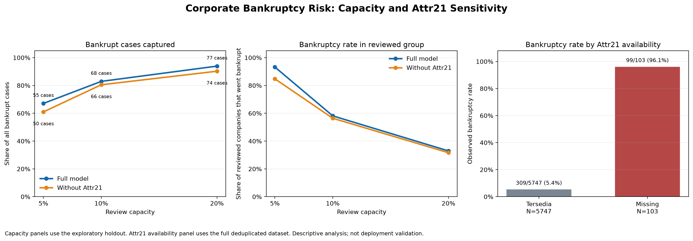

# Corporate Bankruptcy Risk — One-Year Horizon

A portfolio project that builds and validates a rare-event bankruptcy risk ranking for analyst review prioritization.

**Project status:** model comparison and validation are documented; external validation and an operational dashboard remain future work.

## Business question

How can financial ratios help an analyst prioritize a limited number of company records for credit-risk review when bankruptcy events are rare?

This project compares an interpretable Logistic Regression baseline with a nonlinear HistGradientBoosting challenger. The intended use is prioritization for review, not automatic credit approval or rejection.

## Dataset

The project uses the `5year.arff` file from the [UCI Polish Companies Bankruptcy dataset](https://archive.ics.uci.edu/dataset/365/polish%2Bcompanies%2Bbankruptcy%2Bdata). UCI defines the `5thYear` file's label as bankruptcy status after one year.

After removing 60 exact duplicate feature-and-target rows, the working dataset has 5,850 financial-statement records, 64 financial ratios, and 408 bankruptcy events (6.97%). The source file is not committed; see [data access instructions](data/README.md).

## Main results

Nested stratified cross-validation is the primary model-performance estimate.

| Model | Average Precision | ROC-AUC | Top-10% precision | Top-10% recall |
|---|---:|---:|---:|---:|
| Logistic Regression | 0.576 ± 0.050 | 0.895 ± 0.034 | 0.504 ± 0.040 | 0.723 ± 0.054 |
| HistGradientBoosting | **0.804 ± 0.024** | **0.959 ± 0.008** | **0.562 ± 0.016** | **0.806 ± 0.022** |

The values after ± are standard deviations across five outer folds. The top-10% metrics describe an illustrative review-capacity scenario.



On the exploratory holdout, the full model captured 55, 68, and 77 of 82 bankruptcy events at 5%, 10%, and 20% review capacity. The model without Attr21 captured 50, 66, and 74 events, respectively. These holdout scenarios are descriptive; the holdout was examined repeatedly during model and sensitivity analysis.

## Risk and data-quality findings

- Attr27 (operating profit / financial expenses) and Attr21 (current-year sales / prior-year sales) are the leading features in permutation analysis.
- Attr21 is missing in 103 records; 99 of those records are bankrupt. This extreme association may reflect a source-specific reporting pattern. It requires validation before the feature is used in a real portfolio.
- Removing Attr21 reduces five-fold sensitivity-analysis AP from 0.804 to 0.742. Removing both Attr27 and Attr21 reduces AP to 0.569, so the other 62 ratios retain useful signal.
- The model without Attr21 is retained as a robustness challenger.

The missingness association is predictive in this dataset; it does not establish causality or prove target leakage.

## Validation design and limitations

- Hyperparameters are selected in inner stratified folds and assessed in five outer stratified folds.
- The 20% holdout has been reviewed multiple times, so its metrics are exploratory rather than an untouched final estimate.
- Splits are row-level. The available file does not provide company identifiers or observation years for company-level or out-of-time validation.
- This is historical Polish-company data. Results should not be presented as expected default rates for an Indonesian lender or any specific modern portfolio.
- Raw model probabilities are not production-grade probabilities of default. Calibration, cost assumptions, current-population validation, and monitoring are still required.

See [model validation summary](docs/model_validation.md) for the metrics, sensitivity analysis, capacity scenarios, and governance notes.

## Reproduce

Use Python 3.13 and install the pinned dependencies:

```powershell
py -3.13 -m venv .venv
.\.venv\Scripts\python.exe -m pip install -r requirements.txt
```

Download the source file as described in [data/README.md](data/README.md), then run from the project root:

```powershell
.\.venv\Scripts\python.exe scripts/prepare_data.py
.\.venv\Scripts\python.exe scripts/deduplicate_records.py
.\.venv\Scripts\python.exe scripts/inspect_data.py
.\.venv\Scripts\python.exe scripts/split_data.py
.\.venv\Scripts\python.exe scripts/nested_model_comparison.py
```

Additional scripts in `scripts/` reproduce baseline tuning, holdout diagnostics, missingness analysis, feature sensitivity, capacity analysis, and the portfolio figure. Generated CSVs are stored under `data/processed/` and are excluded from Git.

## Repository structure

- `scripts/`: data preparation, model validation, sensitivity analysis, and chart generation.
- `docs/`: dataset selection, feature dictionary, audits, and model validation summary.
- `data/README.md`: instructions for obtaining the public source dataset.
- Raw datasets and all CSV outputs are local-only and excluded from version control.

## Attribution

Tomczak, S. (2016). *Polish Companies Bankruptcy* [Dataset]. UCI Machine Learning Repository. https://doi.org/10.24432/C5F600. Licensed under [CC BY 4.0](https://creativecommons.org/licenses/by/4.0/).

