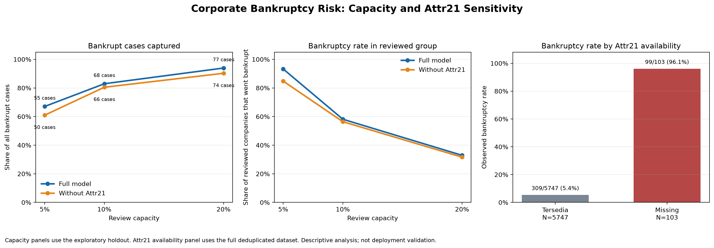

# Model Validation Summary — One-Year Corporate Bankruptcy Risk

## Objective

Rank financial-statement records by their likelihood of bankruptcy within the following year, to illustrate how a credit-risk team could prioritize manual review.

## Data

The selected UCI `5thYear` file contains 5,910 financial-statement records. After removing 60 exact duplicate feature-and-target rows, the working dataset contains 5,850 records: 408 bankruptcy events and 5,442 non-events (6.97% event rate). UCI defines the `5thYear` target as bankruptcy status after one year. [UCI dataset documentation](https://archive.ics.uci.edu/dataset/365/polish%2Bcompanies%2Bbankruptcy%2Bdata)

The dataset has 64 ratios and no usable company identifiers or observation-year fields in the downloaded ARFF file.

## Validation design

Nested stratified cross-validation is the primary estimate. Inner folds select model hyperparameters; five outer folds estimate performance. Reported ± values are standard deviations across those five outer folds.

The stratified 20% holdout was examined repeatedly during model comparison, calibration review, and sensitivity analysis. Its results are therefore exploratory, not an untouched final test estimate.

## Primary model comparison

| Model | Average Precision | ROC-AUC | Top-10% precision | Top-10% recall |
|---|---:|---:|---:|---:|
| Logistic Regression baseline | 0.576 ± 0.050 | 0.895 ± 0.034 | 0.504 ± 0.040 | 0.723 ± 0.054 |
| HistGradientBoosting candidate | **0.804 ± 0.024** | **0.959 ± 0.008** | **0.562 ± 0.016** | **0.806 ± 0.022** |

The average precision random reference is approximately the event prevalence, 0.070. HistGradientBoosting ranked the rare bankruptcy class substantially better in these row-level folds.

## Feature and missingness sensitivity

A fixed-configuration, five-fold sensitivity analysis produced these results:

| Feature set | Average Precision | ROC-AUC |
|---|---:|---:|
| All 64 ratios | 0.804 | 0.958 |
| Without Attr27 | 0.668 | 0.919 |
| Without Attr21 | 0.742 | 0.950 |
| Without Attr27 and Attr21 | 0.569 | 0.905 |
| Only Attr27 and Attr21, native missing values | 0.520 | 0.878 |
| Only missingness indicators for Attr27 and Attr21 | 0.384 | 0.735 |
| Only the two ratios with median imputation | 0.500 | 0.869 |

The two leading ratios carry both value and missingness information. Attr27 is defined as operating profit divided by financial expenses. Attr21 is current-year sales divided by prior-year sales. [UCI ratio definitions](https://archive.ics.uci.edu/dataset/365/polish%2Bcompanies%2Bbankruptcy%2Bdata)

Attr21 is missing in 103 records; 99 of those are bankrupt (96.1%). Among records with Attr21 present, 309 of 5,747 are bankrupt (5.4%). Attr27 is missing in 390 records; 123 are bankrupt (31.5%). These patterns may reflect reporting or data-construction effects. They are predictive associations in this sample, not causal findings and not proof of target leakage.

The full model is the performance candidate. A model without Attr21 is retained as a robustness challenger because Attr21 missingness is unusually informative.

## Review-capacity illustration

The holdout capacity analysis gives the following descriptive scenarios:

| Review capacity | Full model: events captured | Without Attr21: events captured |
|---:|---:|---:|
| 5% (59 records) | 55 of 82 | 50 of 82 |
| 10% (117 records) | 68 of 82 | 66 of 82 |
| 20% (234 records) | 77 of 82 | 74 of 82 |

At 10% review capacity, the full model captures two more events in this holdout. A real review policy requires review-capacity, intervention-cost, and missed-default assumptions.

The capacity panels use the exploratory holdout. The Attr21 availability panel uses the full deduplicated dataset. The figure is descriptive, not deployment validation.

## Limitations and governance

- The data represents historical Polish financial statements. It does not establish suitability for a current lender, a different country, or a modern portfolio.
- Evaluation uses random row-level splits. Without company IDs or observation years, it cannot establish performance on unseen companies or future periods.
- Missing Attr21 is a major data-quality and generalization risk that must be investigated before operational use.
- Discrimination and capacity metrics do not make raw model scores production-ready probabilities of default.
- Calibration, external validation, cost-sensitive policy design, and ongoing drift monitoring remain future work.
- The 20% holdout was reused for diagnostics and should not be described as an untouched final test.

## Source

Tomczak, S. (2016). *Polish Companies Bankruptcy* [Dataset]. UCI Machine Learning Repository. https://doi.org/10.24432/C5F600. Licensed under [CC BY 4.0](https://creativecommons.org/licenses/by/4.0/).
